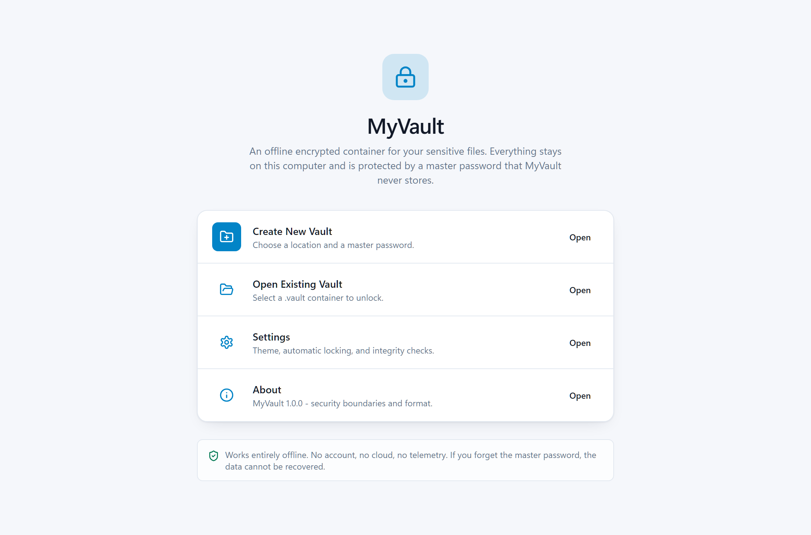
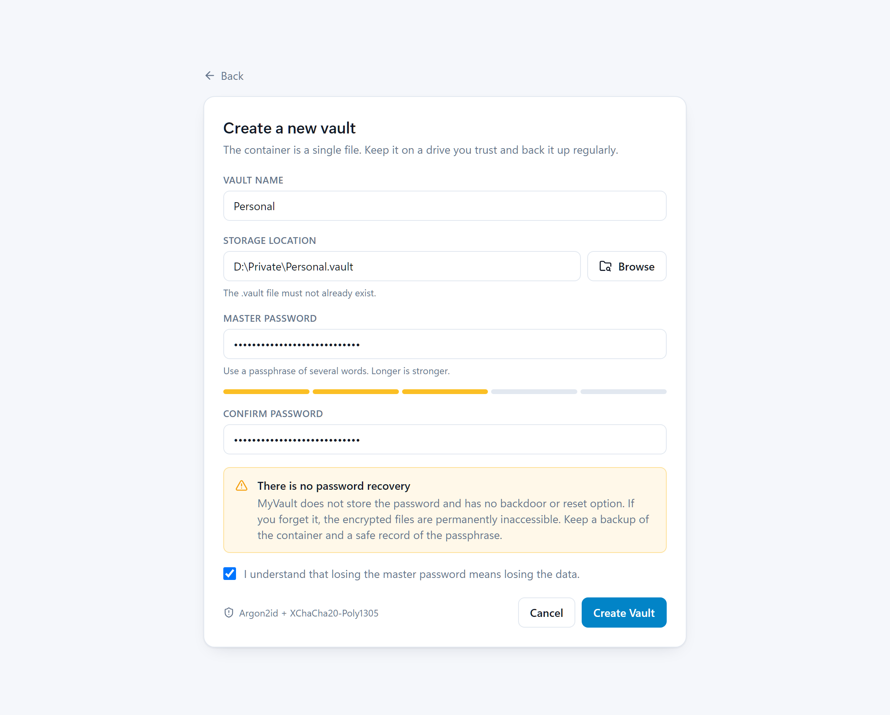
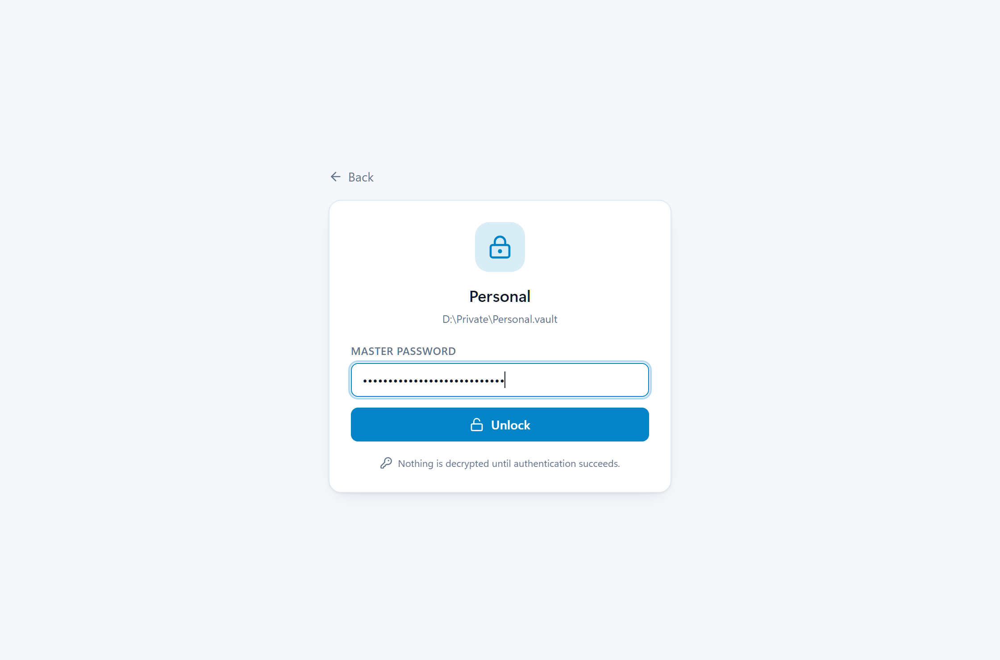
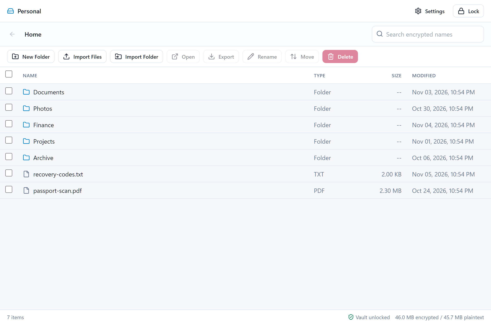
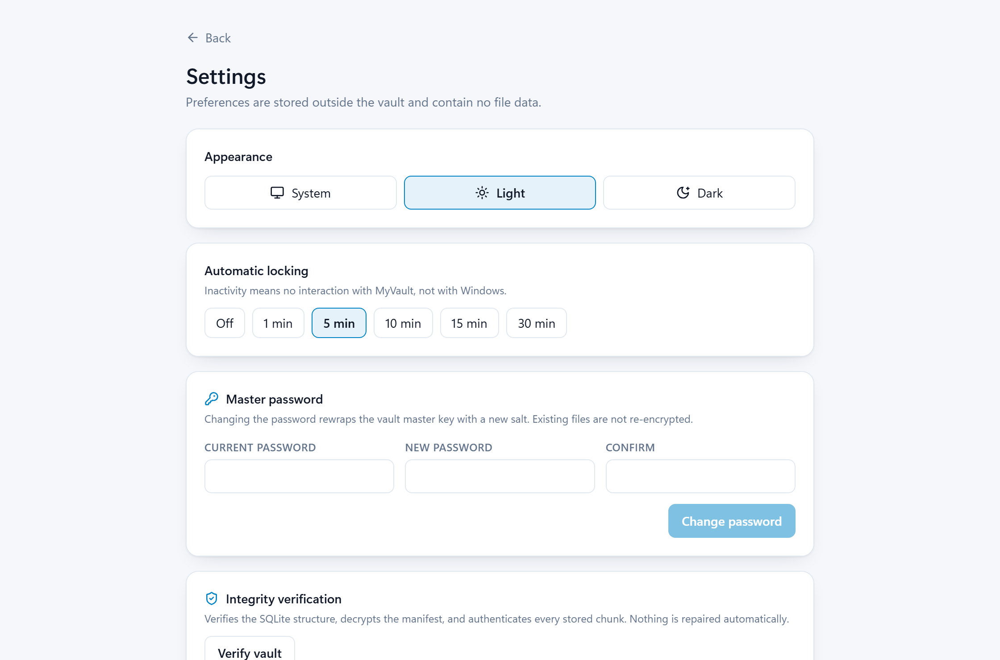
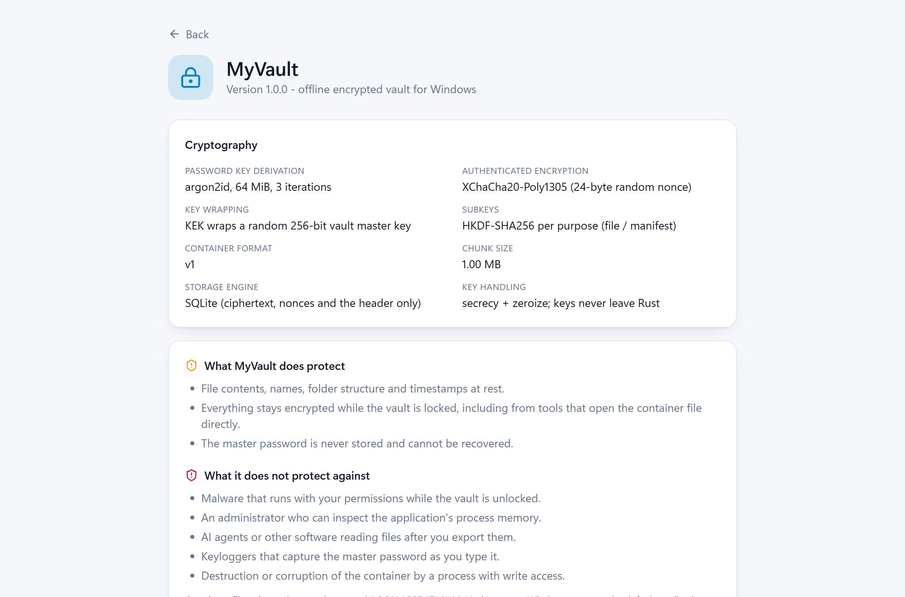
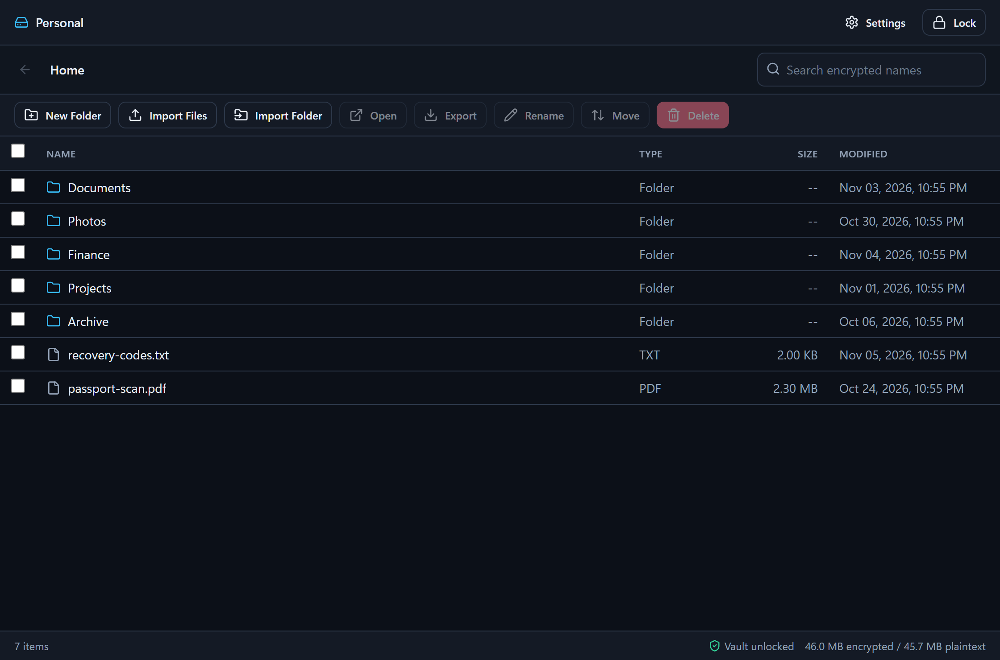

# MyVault

An offline, master-password-protected encrypted file container for Windows 11.

MyVault stores files and folders inside a single `.vault` container. While the
vault is locked, the container reveals nothing about your file names, folder
structure, extensions, timestamps or contents: it holds only ciphertext, random
identifiers and a small header.

- **No cloud. No account. No network.** The application never opens a socket.
- **Real cryptography.** Argon2id for password-based key derivation,
  XChaCha20-Poly1305 for authenticated encryption, envelope encryption with a
  random 256-bit vault master key.
- **A familiar file manager.** Folders, breadcrumbs, drag-and-drop import,
  export, rename, move, delete, filename search, and double-click to open a file
  in its default Windows application from a short-lived decrypted copy.

> **There is no password recovery.** MyVault never stores the master password
> and has no backdoor. If you forget it, the data is permanently inaccessible.

---

## Screenshots

| Welcome | Create a vault |
| --- | --- |
|  |  |

| Unlock | File manager |
| --- | --- |
|  |  |

| Settings | About |
| --- | --- |
|  |  |



---

## Download

Prebuilt Windows binaries are attached to the
**[v1.0.0 release](https://github.com/Syeed-MD-Talha/myvault-desktop/releases/latest)**:

| Artefact | Description |
| --- | --- |
| [`MyVault_Setup.exe`](https://github.com/Syeed-MD-Talha/myvault-desktop/releases/download/v1.0.0/MyVault_Setup.exe) | NSIS installer, installs for the current user (no admin rights) |
| [`MyVault.exe`](https://github.com/Syeed-MD-Talha/myvault-desktop/releases/download/v1.0.0/MyVault.exe) | Portable executable, no installation required |

Both are self-contained: they embed the compiled frontend and need neither
Node.js nor Rust. Windows 11 ships the required WebView2 runtime; on Windows 10
install the Evergreen WebView2 runtime first.

The binaries are unsigned, so SmartScreen may show a warning on first launch.

SHA-256:

```
E7366A0203A865B3469F7AD47BCC5AD6FFF19C73E09499DED19922CA080C8BE5  MyVault_Setup.exe
9A50D04D7B3E59AD25D32DA91474FF775C4A40293EDBB84B30A56D5510404B01  MyVault.exe
```

---

## Contents

| Document | Purpose |
| --- | --- |
| [SECURITY.md](./SECURITY.md) | Threat model, cryptographic design, limitations |
| [USER_GUIDE.md](./USER_GUIDE.md) | Day-to-day usage and troubleshooting |
| [docs/VAULT_FORMAT.md](./docs/VAULT_FORMAT.md) | Byte-level container format |
| [TEST_REPORT.md](./TEST_REPORT.md) | Automated test results and benchmarks |

## Architecture

```
+--------------------------+        IPC (typed commands)        +-------------------+
|  React + TypeScript UI   | <-------------------------------->  |  Tauri (Rust)     |
|  - no keys, no storage   |                                   |  - state, dialogs |
+--------------------------+                                   +---------+---------+
                                                                        |
                                                              myvault-core crate
                                                    +-------------------+-------------------+
                                                    | crypto            | storage           |
                                                    | argon2id, AEAD,   | SQLite container, |
                                                    | HKDF, key wrap    | manifest, chunks  |
                                                    +-------------------+-------------------+
```

The engine (`core/`) has no GUI or Tauri dependency, so every cryptographic and
storage behaviour is testable without launching the application.

Key hierarchy:

```
Master password --Argon2id(salt, params)--> KEK
KEK --XChaCha20-Poly1305--> wrapped random vault master key (VMK)
VMK --HKDF-SHA256("file")--> file chunk key
VMK --HKDF-SHA256("manifest")--> manifest key
```

Changing the password re-wraps the VMK only; no file data is re-encrypted.

## Repository layout

```
core/                     Rust engine (cryptography, storage, services, tests)
  src/crypto/             Argon2id, AEAD, key hierarchy, canonical AAD
  src/storage/            SQLite schema, header, encrypted manifest, chunks
  src/services/           vault lifecycle, import/export, path validation, locks
  tests/                  integration, security and performance tests
src-tauri/                Tauri backend: commands, state, configuration
src/                      React + TypeScript frontend
docs/                     Vault format specification and screenshots
scripts/                  Icon generation and build helpers
```

## Prerequisites

| Tool | Version | Notes |
| --- | --- | --- |
| Rust (MSVC toolchain) | stable 1.80+ | `rustup default stable-x86_64-pc-windows-msvc` |
| Visual Studio Build Tools | 2022 or newer | "Desktop development with C++" (linker + Windows SDK) |
| Node.js | 20+ | Includes npm |
| WebView2 runtime | Evergreen | Preinstalled on Windows 11 |

## Build

```powershell
npm install
npm run build                                    # TypeScript check + Vite bundle
cargo build --release -p myvault --features custom-protocol
```

The `custom-protocol` feature embeds the compiled frontend in the executable
(the Tauri CLI enables it automatically). Without it the binary expects the dev
server on `http://localhost:1420`.

The executable is produced at `target\release\myvault.exe`. It embeds the
compiled frontend, so it runs on a machine without Node.js or Rust.

To build the NSIS installer (the CLI sets the feature and bundles for you):

```powershell
npx tauri build               # -> target\release\bundle\nsis\MyVault_1.0.0_x64-setup.exe
```

The prebuilt artefacts are published as GitHub Release assets rather than
committed to the repository:

```
MyVault.exe          portable executable (no installation required)
MyVault_Setup.exe    NSIS installer for the current user
```

## Run in development

```powershell
npx tauri dev
```

This starts Vite on `http://localhost:1420` and launches the desktop shell with
developer tools enabled.

## Tests

```powershell
cargo test                    # 93 unit + integration + security tests
cargo test -- --ignored       # performance benchmarks (not run by default)
```

See [TEST_REPORT.md](./TEST_REPORT.md) for the recorded results.

## Design decisions

- **Envelope encryption** keeps password changes cheap and lets the format
  evolve without re-encrypting stored files.
- **Purpose-bound subkeys** (file vs manifest) mean a chunk can never be
  accepted as manifest data, even if the associated data were ignored.
- **Canonical AAD encoding** uses fixed-width length-prefixed fields rather than
  string concatenation, so contexts cannot collide.
- **One transaction per mutation.** Chunks and the manifest commit together;
  a crash leaves either the previous state or the new one, never a partial file.
- **SQLite only ever sees ciphertext.** Names, structure and contents are
  inside the encrypted manifest.
- **Every chunk is independently authenticated** and bound to the vault id, file
  id and chunk index.
- **The Rust backend is the only place keys exist.** The frontend receives
  metadata only, never key material.

## Known limitations

- Opening a file creates a short-lived decrypted copy under
  `%LOCALAPPDATA%\MyVault\open` (deleted on Lock/Exit). A crash, a system
  shutdown or another application's temporary files can outlive that window.
- Exported files are plaintext copies: indexing, backups, cloud sync and SSD
  wear levelling can retain them.
- MyVault cannot protect against malware, an administrator inspecting process
  memory, or a keylogger while the vault is unlocked.
- Windows virtual-drive mounting, Windows Hello, recovery keys and multi-user
  support are explicitly out of scope for 1.0.

## License

MIT. See [LICENSE](./LICENSE) for details.
